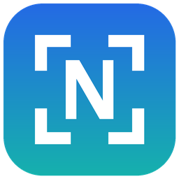

<p align="center">
  
</p>

<h1 align="center">Nab</h1>

<p align="center">
  <b>Nab the text from anything on your screen.</b><br>
  Hold <kbd>Ctrl</kbd>+<kbd>Shift</kbd> and click on any text. Paste.
</p>

<p align="center">
  <a href="../../actions/workflows/ci.yml"></a>
  <a href="../../actions/workflows/security.yml"></a>
  <a href="https://scorecard.dev/viewer/?uri=github.com/puente-digital-uk/nab"></a>
  <a href="LICENSE"></a>
</p>

<p align="center">
  <a href="../../releases"><b>⬇ Download for Windows (beta)</b></a> ·
  <a href="https://buymeacoffee.com/puentedigital">☕ Buy me a coffee</a> ·
  <a href="https://www.puentedigital.co.uk/">Puente Digital</a>
</p>

<!-- Demo GIF goes here once recorded: drag over a table in a PDF, paste into Excel (assets/demo.gif, ~10 s). -->

---

Text stuck in an image, a video, a screenshot, a PDF that won't let you select, an error dialog, a locked-down app? Ctrl+Shift+click it. Nab finds the paragraph under your pointer, works out where it starts and ends, and puts it on your clipboard.

- **Click, don't fiddle.** It detects the block of text under the pointer: a paragraph, heading, label or table cell. Drag a box instead if you want something exact.
- **Tables paste into Excel as real cells.** Drag over a table in a PDF, screenshot or shared screen, then paste into Excel, Word or an email. Rows and columns are kept.
- **Clean text.** Lines that only broke because the text wrapped are joined back into paragraphs, and words hyphenated across a line end are rejoined. Lists, addresses and indented code keep their line breaks. A % sign misread as "0/0" or "o/o" is put back.
- **Works on anything you can see.** Images, videos, games, remote desktops, scanned PDFs, any app.
- **Private and offline.** It uses the OCR engine built into Windows 10/11. Nothing is uploaded, and there's no account and no telemetry.
- **Counts what it saves.** Text you can't select usually means: screenshot it, paste it into an OCR or AI tool, wait, copy the result, come back. Nab is one click. It counts each copy as about 20 seconds and 5 steps saved (a minute and 7 steps for a table) and keeps a running total.
- **Tiny.** One small `.exe`, no installer, no runtime, no downloads. It sits quietly in the tray.
- **Any language Windows supports.** It reads in your Windows display languages.
- **Free and open source** (MIT).

> **Beta.** Nab works and is used every day, but it's new: expect rough edges, and please [report](../../issues) what you hit. Releases stay marked "pre-release" until 1.0.

## Install

1. Download `nab.exe` from the latest [release](../../releases). Put it wherever you like (Documents, a tools folder); there is no installer.
2. Run it. If Windows SmartScreen says it *prevented an unrecognised app from starting*, click **More info → Run anyway**. That warning appears because this build isn't code-signed yet, not because anything is wrong with it. You can check the file against the SHA-256 in the release notes: `Get-FileHash nab.exe` in PowerShell.
3. Nab's window opens once and then sits in the tray (the **N** icon near the clock). Tick **Start with Windows** if you want it always there.

**To uninstall:** right-click the tray icon → **Exit**, untick **Start with Windows** first if you ticked it, and delete `nab.exe`. Settings live in `HKCU\Software\PuenteDigital\Nab`; delete that key to remove every trace.

*Microsoft Store:* a Store version (signed by Microsoft, no SmartScreen prompt, uninstalls from Settings › Apps) is in preparation. The link will be here when it's live.

## Use it

1. Hold **Ctrl+Shift** and **click** on some text. It flashes green and is copied.
   Or hold **Ctrl+Shift** and **drag** a box around exactly what you want.
2. Paste anywhere. A notification shows what was copied and what it saved you.

**Tables:** Ctrl+Shift+**drag** over a table and paste it into Excel. It arrives in rows and columns, and the notification says *Copied a table · 5 × 3*. Plain-text apps get tab-separated text. Clicking a single block always gives plain text, so a click on a chat message or a file list never turns into a table.

Prefer the keyboard? Press **Alt+Space**. The screen freezes, and hovering highlights each block of text. Click one, or drag a box. <kbd>Esc</kbd> or right-click cancels.

> While Nab runs it takes over Alt+Space, which normally opens a window's Move/Size/Close menu. Tools like PowerToys Run may want it too: whichever starts first gets it. If Nab doesn't, its window shows the shortcut as taken, and you can pick another there.

### Change the shortcuts

Open Nab (click the tray icon), press **Change** next to a shortcut, then:

- **Click or drag:** hold the keys you want and click any mouse button: left, right, middle, or the back/forward side buttons.
- **Keyboard:** press the new key combination.

Press **Delete** to turn a shortcut off, or **Esc** to cancel. Your choice is saved. Tick **Start with Windows** to always have it handy.

> The mouse shortcut takes over that click everywhere while Nab runs. If an app you use needs Ctrl+Shift+click (some browsers use it to open a link in a new tab), pick something else, such as Ctrl+Alt+click or Ctrl+middle click.

## Safe to run

Nab reads your screen and writes to your clipboard, so it's held to a higher bar than a toy. Every push is checked by cargo-deny (dependency advisories and licences), GitHub CodeQL and OpenSSF Scorecard; every release's `nab.exe` is scanned by VirusTotal with the result linked in the release notes, and its SHA-256 is published alongside it. The exe is built from the tagged source by GitHub Actions, with Control Flow Guard and a statically linked runtime, and it has no network code at all. Details, and how to report a problem, in [SECURITY.md](SECURITY.md).

## Private

Nab never connects to the internet. The text it reads stays on your PC: it uses the OCR engine built into Windows, keeps its settings and the time-saved counter in your user registry, and the only outgoing links are the ones you click in its window (this page, Puente Digital, Buy me a coffee). No account, no analytics, no crash reporting. Details in [PRIVACY.md](PRIVACY.md).

## Build from source

You need [Rust](https://rustup.rs) on Windows (default MSVC toolchain).

```powershell
.\build.ps1        # lint, run every test, build the release .exe
```

or step by step:

```powershell
cargo test -- --test-threads=1   # unit tests plus real OCR, clipboard and registry tests
cargo build --release            # -> target\release\nab.exe
```

The tests run against Windows itself. They draw text and read it back with the real OCR engine. They put a window of text on screen and drive the same click-and-drag code the mouse shortcut uses, and they check that taken shortcuts are refused. They also round-trip the clipboard, settings and start-with-Windows. While they run, your clipboard gets overwritten and a few windows flash on screen, so leave the mouse and keyboard alone until they finish. They keep their own settings and start-with-Windows entry (`Nab-tests`), so your real Nab setup is never touched.

## How it works

| File | What it does |
|---|---|
| `src/main.rs` | Tray icon, single instance, message loop |
| `src/shortcuts.rs` | Keyboard hotkey and the mouse shortcut (a low-level mouse hook on its own thread) |
| `src/capture.rs` | Freezes every monitor, finds text blocks in the background, hover / click / drag |
| `src/blocks.rs` | Groups OCR words into lines, blocks and tables; joins wrapped lines back into paragraphs |
| `src/ocr.rs` | Runs `Windows.Media.Ocr`; word positions for detection, an enlarged re-read for accuracy |
| `src/trigger.rs` | Shortcut parsing, naming and validation |
| `src/home.rs` | The little window (custom-painted GDI, DPI-aware, dark) |
| `src/sys.rs` | Clipboard, start-with-Windows, links |
| `src/logic.rs` | Pure helpers (geometry, pixels, text), unit-tested on any OS |

The only dependency is Microsoft's [`windows`](https://github.com/microsoft/windows-rs) crate.

### Releases and the Store package

Pushing a `v*` tag that matches the version in `Cargo.toml` makes GitHub Actions lint, test and build on a clean Windows runner, then publish `nab.exe` with its SHA-256 as a GitHub Release. The same run builds `Nab.msix`, the package for the Microsoft Store. To build it yourself (needs the Windows SDK):

```powershell
.\msix\build.ps1 -DevSign   # self-signed package for local testing
.\msix\install-dev.ps1       # install it (asks for admin once, to trust the test certificate)
```

See [msix/STORE.md](msix/STORE.md) for the Store submission steps.

## Support

If Nab saves you time, [**buy me a coffee ☕**](https://buymeacoffee.com/puentedigital). It keeps free tools like this coming.

Built by **[Puente Digital](https://www.puentedigital.co.uk/)**. We build governed, AI-ready data platforms on Microsoft Fabric and Databricks for UK organisations. Need help getting your data ready for AI? [Get in touch](https://www.puentedigital.co.uk/).

## Licence

MIT © 2026 Pablo Puente / Puente Digital
